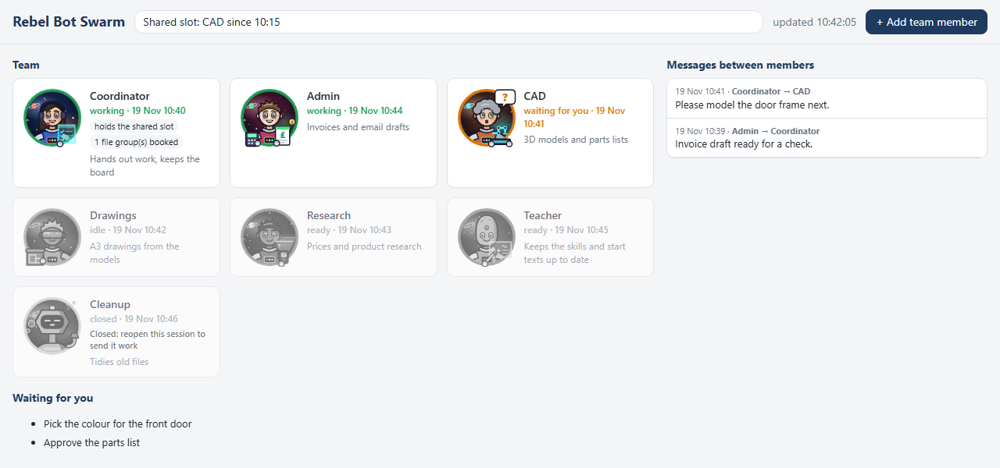
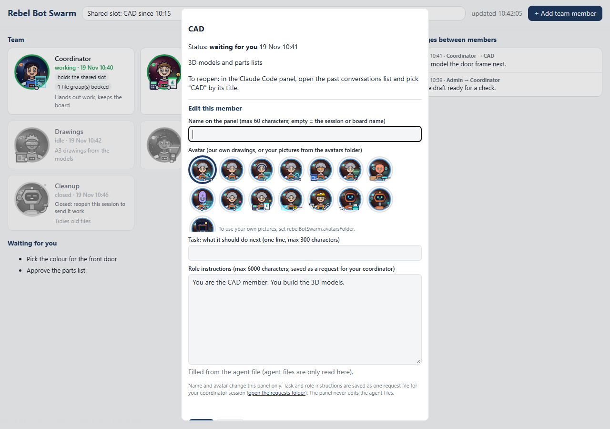

# Rebel Bot Swarm

See your Claude Code sessions as one team, in a VS Code panel.



> **Unofficial add-on.** Rebel Bot Swarm is not made by, endorsed by or affiliated with Anthropic. It depends on
> Claude Code's local session files, which are not a public interface and may change in any Claude Code update.

## What it shows

- **A card for each session:** an original cartoon avatar chosen by the member's role, its status (working, idle,
  ready, waiting for you, closed), the time of the last change, its job, and the files it holds. Idle, ready and
  closed members show as grey cards, so the busy members stand out.
- **Edit a member:** click a card to change the name on the panel and the avatar (14 drawn styles or your own
  pictures), and to give a next task or new role instructions. The task and role instructions are saved as a request
  file for your coordinator session. The panel never edits your agent files.
- **Add team member:** saves a request for a new member (name and job) for your coordinator session.
- **Closed sessions:** a closed tab ends the session. Its card says "reopen this session to send it work" and shows
  how to reopen it.
- **The shared slot:** which member holds a shared app (from your board).
- **Waiting for you:** the open questions from your board.
- **Messages between members:** time, sender, receiver and the first line of each message. Private members show
  their status only.

The avatars are our own designs: space crew, two alien species of our own, and helper robots, each with a prop for
its role. Roles come from words in the member's name or job (for example Coordinator, CAD, Drawings, Research, Admin,
Teacher, Personal). Other members get a crew look chosen from a hash of the name.



## Nothing leaves your computer

- No network: the panel makes no web requests and loads no remote content (strict content security policy).
- No telemetry.
- It reads `~/.claude/sessions/*.json`, the transcript files of your projects (only the new bytes at each refresh),
  your board file and, for the edit panel (or with `agentCards` on), `~/.claude/agents/*.md`. It never writes to them.
- It reads only while its panel is open and visible. The status-bar button only opens the panel.
- It writes only when you click Save in the panel: the names and avatars you choose (a members file, with a backup
  before each change) and small request files (`NEW MEMBER <time>.json`, `EDIT MEMBER <time>.json`). These go to
  VS Code's storage folder for this extension, or to the file and folder you set.

## Install

1. In VS Code, open the Extensions view, search for **Rebel Bot Swarm** and click **Install**. VS Code installs
   updates by itself.
2. Open it with the **Swarm** button in the status bar, or the command **Rebel Bot Swarm: Show**.

Or install a file: get `rebel-bot-swarm-<version>.vsix` from the
[Releases page](https://github.com/simonjamesfowler-ux/rebel-bot-swarm/releases), then in the Extensions view use the
`...` menu, **Install from VSIX...**

Works on Windows, macOS and Linux with VS Code 1.80 or later and Claude Code.

## Settings

| Setting | Default | What it does |
|---|---|---|
| `rebelBotSwarm.boardFile` | empty | Your team board (Markdown). Empty = cards for live sessions only. |
| `rebelBotSwarm.privateMembers` | `[]` | Members whose messages stay hidden; their status still shows. |
| `rebelBotSwarm.refreshSeconds` | `5` | How often the open panel reads (2 to 60). |
| `rebelBotSwarm.scope` | `workspace` | `workspace` = sessions started in the open folders; `all` = every live session. |
| `rebelBotSwarm.avatarsFolder` | empty | Folder of your own pictures, named after members (`Coordinator.png`). |
| `rebelBotSwarm.requestsFolder` | empty | Folder for the request files (Add team member, task, role instructions). Empty = VS Code's storage folder for this extension. |
| `rebelBotSwarm.membersFile` | empty | File for the names and avatars you choose in the edit panel. Empty = `members.json` in VS Code's storage folder. |
| `rebelBotSwarm.agentCards` | `false` | Also show a ready card for each agent file in `~/.claude/agents/` that has no card yet. |

Command **Rebel Bot Swarm: Open requests folder** opens the folder where the request files are saved.

## The board (optional)

A Markdown file kept by your coordinator session. The panel reads these sections:

```markdown
## Shared-app slot
| | |
|---|---|
| Holder | **CAD** since 10:15 |

## Files being edited
| File | Session | Since |
|---|---|---|
| plan.md | Drawings | 09:40 |

## Sessions
| Session | Job and state |
|---|---|
| Coordinator | Hands out work, keeps this board |
| CAD | 3D models |

## Waiting for the user
- Pick the colour for the front door
```

The guide in `docs/` ("Running a Team of Claude Code Sessions", Markdown and PDF) explains the board, the roles and
the way a team works.

## Licence

MIT, see `LICENCE.md`. Copyright (c) 2026 simonjamesfowler-ux.
