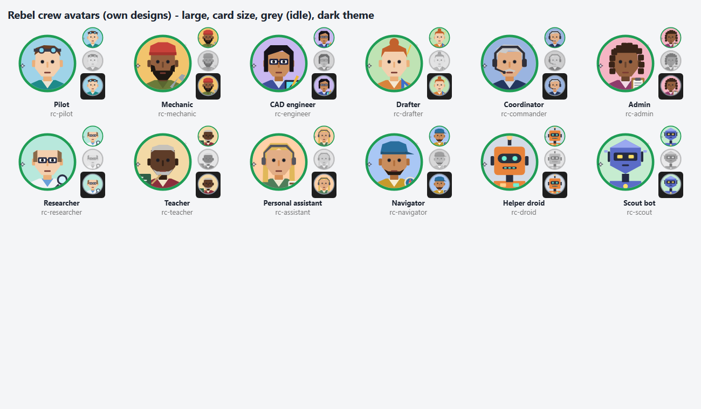

# Rebel Bot Swarm

See your Claude Code sessions and helpers as one team, on a dashboard in a VS Code panel.

## Start here

New to Rebel Bot Swarm? Do these four steps (also in VS Code: **Help > Get Started > Start here: Rebel Bot Swarm**,
and on the dashboard until you hide it):

1. **Open and close the dashboard:** click **Swarm** in the status bar (bottom left) to open it, and again to close
   it. Or use the **Rebel Bot Swarm** icon in the activity bar (left edge: buttons and a 3-line status), the keys
   **Ctrl+Alt+S** (Windows, Linux), or the command **Rebel Bot Swarm: Toggle dashboard**.
2. **Name your leader, then press OPEN:** type your team leader's name in **Start here** (default "Coordinator").
   The **OPEN** button (it shows the name on the leader's card, for example OPEN OBI) opens a new Claude Code chat with a starter prompt in the
   chat box. Press Enter, then say what you want to do. The chat hands the task to the right member (a subagent from
   `~/.claude/agents`) or writes a request file for your coordinator.
3. **Close chat tabs when the job is handed over:** the dashboard keeps watching your team.
4. **Save team** to keep your pictures, names and settings safe (see "Keep your team safe").


> **Unofficial add-on.** Rebel Bot Swarm is not made by, endorsed by or affiliated with Anthropic. It depends on
> Claude Code's local session files, which are not a public interface and may change in any Claude Code update.

## What it shows

- **Summary tiles:** members working, waiting for you, idle or ready, jobs done today, messages today, and the
  holder of the shared slot.
- **A small card for each session:** an original cartoon avatar chosen by the member's role, its name, its status
  (working, idle, ready, waiting for you, closed) with the time of the last change, and its role or TEAM LEAD tag.
  A team member's card has a stripe in the team colour. Click a card for the full view: its job, the files it holds
  and the Condense button. Idle, ready and closed members show as grey cards, so the busy members stand out.
- **Edit a member:** click a card to change the name on the panel and the avatar (14 drawn styles or your own
  pictures), and to give a next task or new role instructions. The task and role instructions are saved as a request
  file for your coordinator session. The panel never edits your agent files.
- **Add team member:** the new card shows on the dashboard at once (as ready), and a request with its name and job is
  saved for your coordinator session to set it up. Each card is known by the first word of its name, so start a new
  name with a word no other card starts with.
- **Closed sessions:** a closed tab ends the session. Its card is grey, and its full view (click the card)
  says how to reopen it.
- **The shared slot:** which member holds a shared app (from your board).
- **Waiting for you:** the open questions from your board.
- **Working window:** who is working now and the current step, recent progress lines, the messages between members
  (briefs from the coordinator, reports back, and messages), and the `## Log` lines of your board. It reads the helper
  (subagent) transcripts that Claude Code writes. Private members show their status only, never their text.
- **Comms lines:** when one member hands over to another, a glowing line with a moving pulse runs from the sender's
  avatar to the receiver's and fades after about 15 seconds. Recent links stay as faint lines. Tick **Network view**
  to see the members as nodes on a ring, with the busiest one in the middle.
- **Tokens (top row):** a small pop-out with each member's token use today and the team total, read from the
  `usage` fields Claude Code writes in the chat transcripts (each reply counted once; "not known" when there is none).
- **Brain and Digest (edit panel):** the member's own Markdown notes (Claude Code's subagent memory if you use the
  `memory:` field in the agent file, else a file in the brains folder), and a Digest box to give the member a text,
  link or file to learn. The Digest box saves a request file for your coordinator session.

The avatars are our own designs: space crew, two alien species of our own, helper robots, and the **Rebel crew**
set of flat geometric faces and bots (pilot, mechanic, CAD engineer, drafter, coordinator, admin, researcher, teacher,
personal assistant, navigator, helper droid, scout bot), each with a prop for its role. In the edit panel, pick one
from the avatar dropdown, use **Upload picture...** (PNG, JPEG or WebP, max 2 MB), or **Create...** (Botify): paste,
drop or choose a photo, drag the circle onto the face and press Botify for a flat cartoon head you can adjust (skin,
hair, beard, eyes, glasses). The photo is read inside the dashboard and never leaves your computer; only the drawing
is saved, as a new BOTIFY file in the avatars folder. Roles come from words in the member's name or job (for example Coordinator, CAD, Drawings, Research, Admin,
Teacher, Personal). Other members get a crew look chosen from a hash of the name.




## Nothing leaves your computer

- No network: the panel makes no web requests and loads no remote content (strict content security policy).
- No telemetry.
- It reads `~/.claude/sessions/*.json`, the transcript files of your projects (only the new bytes at each refresh),
  the helper transcripts `<project>/<session>/subagents/agent-*.jsonl` of the last 24 hours (first and last bytes
  only), your board file, `~/.claude/agents/*.md` and the member's brain file. It never writes to them.
- It reads only while its panel is open and visible. The status-bar button opens or closes the panel. The activity-bar view reads the three counts only while it is visible.
- It writes only when you click a button in the panel: the names and avatars you choose (a members file, with a
  backup before each change), small request files (`NEW MEMBER <time>.json`, `EDIT MEMBER <time>.json`,
  `DIGEST <time>.json`, plus a copy of a file you attach), a picture you upload (copied into the avatars folder,
  never over a file), and an empty brain file when you ask for one. These go to VS Code's storage folder for this
  extension, or to the files and folders you set.
- **Save team** writes one `.zip` file where you choose. **Restore team** writes only after you say yes.

## OPEN (start your team leader)

**OPEN** (dashboard button, command **Rebel Bot Swarm: Open the team leader in a new chat**) opens a new Claude Code chat with the
starter prompt from the setting `rebelBotSwarm.sparkPrompt` in the chat box. It is not sent until you press Enter.
The default prompt makes the chat your team leader: it says "Hi, I'm (leader name). What would you like to do?", hands
the task to a matching subagent or writes one `REQUEST <time>.json` file in the requests folder, and tells you when
you can close the tab. Edit the setting to change it (`{leader}`, `{leaderRole}`, `{agentsFolder}`,
`{requestsFolder}` and `{board}` are filled in for you).

**Your team leader:** set the name in **Start here** on the dashboard, with the command **Rebel Bot Swarm: Set leader
name**, or in the settings `rebelBotSwarm.leaderName` (default "Coordinator", for example "Ada") and
`rebelBotSwarm.leaderRole` (default "the team leader and coordinator"). The **OPEN** button shows the name on the leader's card (narrow windows show the first word; the tooltip has the full name). The
leader card has a violet border and a **LEAD** badge (a violet ring in Network view). It is the card with the
leader's name (board row or edit-panel name); if there is none, the board row whose job says coordinator or leader;
if there is none, a new ready card. The new chat tab keeps Claude Code's own name: Claude Code can rename a tab only
after its first message, and it asks you for the name (command **Claude Code: Rename Session Tab**).
The new chat opens in the editor group to the right of the dashboard, so the dashboard stays in view (that group is
used again on the next click). OPEN uses Claude Code commands that are not a public interface. If they do not work, the prompt goes on the
clipboard and the Claude Code side bar opens: paste the prompt there.

## Condense or restart a chat

Each card with an open chat has a **Condense ▾** button and the chat's context size (for example `300k`). The
button works only when it is safe: the member is idle (no helper running, none it started still running, not waiting for you), no open "Waiting for"
item on the board names the member, and the board job does not say it is still running (in progress, working on...).
Hover over a grey button to see why it is off. The button is orange and pulses when the chat is large (setting
`rebelBotSwarm.condenseTokens`, default 250000) or the board job says done.

Click it and choose **Condense** (`/compact`) or **Restart** (a new chat). First the member saves what it learned to its
brain: the BRAIN SAVE prompt (setting `rebelBotSwarm.condensePrompt`) goes on the clipboard and the member's chat comes
to the front (Claude Code fills the chat box only if the chat was not open). Paste it, send it, and when the member
replies "BRAIN SAVED", type `/compact` (or close the chat and click **New chat** in the notice). A `CONDENSE <time>.json`
request file goes to the requests folder for your leader.

## Teams inside the swarm

Split a big swarm into teams. A team can be a colour (`Red`) or a work area (`Website`), with its own leader.

1. Press **Create team...** at the top of the dashboard (or run **Rebel Bot Swarm: Create team**). Type the name,
   tick its members (cards with no team yet: a member already in a team stays where it is), choose its leader and,
   a colour, and if you like, one line for what it works on. Then choose **Show it in this window** or **Stay on whole swarm**.
   The teams are kept in the user setting `rebelBotSwarm.teams`, for example
   `[{"name": "Website", "leader": "Ada", "scope": "site pages, blog, downloads", "color": "#2563eb"}]`.
2. To change a member later, click its card. In the edit panel, choose its **Team** and its **Role** (`Team leader`, plus the names in the
   setting `rebelBotSwarm.roles`, default Member, Specialist, Helper). Save.
3. The dashboard groups the cards: the swarm leader first (above all teams), then each team with its leader first,
   then **No team**. In Network view the swarm leader is in the middle, team leaders on an inner ring and each team's
   members together outside, with dotted team lines in the team colour.
4. **Sub-teams** (one level): in Create team, answer **Is it part of another team?** with that team. The sub-team
   shows under its parent, and in Network view its leader hangs from the parent's leader. Create team may move
   members of the parent team into the sub-team. A window that shows the parent team shows its sub-teams too.
   In the setting, a sub-team has `"parent": "<team name>"`.
5. **Change a team's colour** or **delete a team**: press **Team ▾** at the top and choose **Change team colour...** or
   **Delete team...** (or run **Rebel Bot Swarm: Change team colour** / **Delete team**). Deleting a team only takes
   its members out of it: every card, name, picture and role stays, and its sub-teams become teams of their own.

**One team per window.** You can have the dashboard open in several VS Code windows. In a window that works for one
team, press **Team: Whole swarm ▾** at the top (or run **Rebel Bot Swarm: Switch team**) and choose the team (or set `rebelBotSwarm.team` in the *Workspace*
settings). That window shows the swarm leader and that team only, and **OPEN** starts that team's leader. Empty =
the whole swarm. The teams list is a user setting and the member data is one shared file, so a change in one window
shows in the others at the next refresh. A save is refused if the same member was saved in another window since the
card was opened (open the card again and save).

## Keep your team safe

By default your members file, pictures and panel brains are in VS Code's storage folder for this extension. VS Code
can delete that folder when you uninstall the extension. To keep them safe:

- Click **Save team...** at the top of the panel (or run **Rebel Bot Swarm: Save team**). It writes one `.zip` file
  where you choose: `members.json`, your pictures, the panel brains, your `rebelBotSwarm.*` settings and a
  `manifest.json` (version, date, file list). Private members' brains are left out.
- Extra groups are off by default; tick them to add them: Claude Code member brains (`~/.claude/agent-memory/*`),
  agent files (`~/.claude/agents/*.md`), skills (`~/.claude/skills/*`, not the `synced` folder) and Claude Code
  project memory (`~/.claude/projects/*/memory`). Project memory can hold private notes: keep that file private.
- Never saved: Claude Code's `settings.json`, credentials, `.env` files, keys, tokens and transcripts.
- **Restore team...** (or **Rebel Bot Swarm: Restore team**) reads a Save team `.zip` file or folder. It checks every
  file name and type (pictures by their first bytes, size limits), shows what it will add or replace, and asks
  before it writes. It keeps a dated copy of each file or setting it replaces.
- Or set `rebelBotSwarm.avatarsFolder`, `rebelBotSwarm.membersFile` and `rebelBotSwarm.brainsFolder` to a folder of
  your own (for example one that you back up).

## Install

1. In VS Code, open the Extensions view, search for **Rebel Bot Swarm** and click **Install**. VS Code installs
   updates by itself.
2. Open it with the **Swarm** button in the status bar, or the command **Rebel Bot Swarm: Show**.

Or install a file: get `rebel-bot-swarm-<version>.vsix` from the
[Releases page](https://github.com/simonjamesfowler-ux/rebel-bot-swarm/releases), then in the Extensions view use the
`...` menu, **Install from VSIX...**

Works on Windows, macOS and Linux with VS Code 1.80 or later and Claude Code.

## Settings

| Setting | Default | What it does |
|---|---|---|
| `rebelBotSwarm.boardFile` | empty | Your team board (Markdown). Empty = cards for live sessions only. |
| `rebelBotSwarm.privateMembers` | `[]` | Members whose messages stay hidden; their status still shows. |
| `rebelBotSwarm.refreshSeconds` | `5` | How often the open panel reads (2 to 60). |
| `rebelBotSwarm.scope` | `workspace` | `workspace` = sessions started in the open folders; `all` = every live session. |
| `rebelBotSwarm.avatarsFolder` | empty | Folder of your own pictures, named after members (`Coordinator.png`); **Upload picture** copies new ones here. Empty = VS Code's storage folder. |
| `rebelBotSwarm.brainsFolder` | empty | Folder for member brain files (`<member>.md`) when Claude Code's own subagent memory is not used. Empty = VS Code's storage folder. |
| `rebelBotSwarm.requestsFolder` | empty | Folder for the request files (Add team member, task, role instructions). Empty = VS Code's storage folder for this extension. |
| `rebelBotSwarm.membersFile` | empty | File for the names and avatars you choose in the edit panel. Empty = `members.json` in VS Code's storage folder. |
| `rebelBotSwarm.agentCards` | `false` | Also show a ready card for each agent file in `~/.claude/agents/` that has no card yet. |
| `rebelBotSwarm.leaderName` | `Coordinator` | Your team leader's name: OPEN opens the chat as this leader; the leader card gets a LEAD badge. |
| `rebelBotSwarm.leaderRole` | `the team leader and coordinator` | The leader's role in the OPEN starter prompt. |
| `rebelBotSwarm.sparkPrompt` | (default text) | The OPEN starter prompt; `{leader}` and `{leaderRole}` are filled in. |
| `rebelBotSwarm.leaderSessionId` | (empty) | Your leader's own chat (its session id). **Decide ▸** puts `DECIDE: <item>` in this chat and writes a `DECIDE <time>.json` request file. Empty = the newest chat whose tab title starts with the leader name. |
| `rebelBotSwarm.decidePrompt` | (default text) | The prompt that **Decide ▸** puts in a new chat when no leader chat is found; `{leader}`, `{leaderRole}`, `{item}`, `{board}`, `{requestsFolder}` are filled in. |
| `rebelBotSwarm.condenseTokens` | 250000 | A card highlights **Condense** when its chat context is this many tokens or more. |
| `rebelBotSwarm.condensePrompt` | (default text) | The BRAIN SAVE prompt that **Condense** gives the member before `/compact` or a restart; `{member}`, `{action}`, `{actionPast}`, `{actionNext}` are filled in. |
| `rebelBotSwarm.teams` | [] | Teams: `[{"name", "leader", "scope", "color", "parent"}]` (user setting, the same in all windows). |
| `rebelBotSwarm.roles` | Member, Specialist, Helper | The roles in the edit panel; Team leader is always there. |
| `rebelBotSwarm.team` | (empty) | Workspace setting: the one team this window shows; OPEN starts its leader. Empty = whole swarm. |
| `rebelBotSwarm.showUnnamedSessions` | `false` | Show a card for a session that still has its default title (the folder name) and is not on the board. |

Command **Rebel Bot Swarm: Open requests folder** opens the folder where the request files are saved.

**Matching members to agent files:** a card gets its role instructions and brain from the agent file whose file name,
`name:` line or leading name in the `description:` line matches the member's name ("Ada Lovelace - CAD" matches
`ada-lovelace.md` or `ada.md`). For any other name, add `"agent"` to the member in the members file:
`{ "ada": { "agent": "cad-lead" } }`.

## The board (optional)

A Markdown file kept by your coordinator session. The panel reads these sections:

```markdown
## Shared-app slot
| | |
|---|---|
| Holder | **CAD** since 10:15 |

## Files being edited
| File | Session | Since |
|---|---|---|
| plan.md | Drawings | 09:40 |

## Sessions
| Session | Job and state |
|---|---|
| Coordinator | Hands out work, keeps this board |
| CAD | 3D models |

## Waiting for the user
- Pick the colour for the front door

## Log
- 21 Nov 10:05 CAD: frame rebuilt; pictures saved
```

The guide in `docs/` ("Running a Team of Claude Code Sessions", Markdown and PDF) explains the board, the roles and
the way a team works.

## Licence

MIT, see `LICENCE.md`. Copyright (c) 2026 simonjamesfowler-ux.
