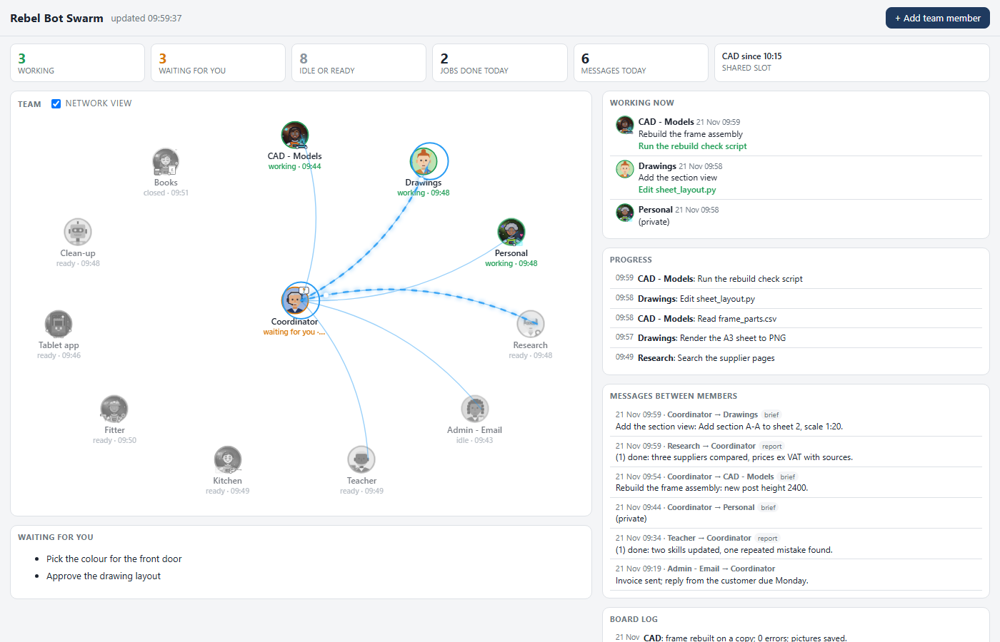

# Rebel Bot Swarm

See your Claude Code sessions and helpers as one team, on a dashboard in a VS Code panel.


> **Unofficial add-on.** Rebel Bot Swarm is not made by, endorsed by or affiliated with Anthropic. It depends on
> Claude Code's local session files, which are not a public interface and may change in any Claude Code update.

## What it shows

- **Summary tiles:** members working, waiting for you, idle or ready, jobs done today, messages today, and the
  holder of the shared slot.
- **A card for each session:** an original cartoon avatar chosen by the member's role, its status (working, idle,
  ready, waiting for you, closed), the time of the last change, its job, and the files it holds. Idle, ready and
  closed members show as grey cards, so the busy members stand out.
- **Edit a member:** click a card to change the name on the panel and the avatar (14 drawn styles or your own
  pictures), and to give a next task or new role instructions. The task and role instructions are saved as a request
  file for your coordinator session. The panel never edits your agent files.
- **Add team member:** saves a request for a new member (name and job) for your coordinator session.
- **Closed sessions:** a closed tab ends the session. Its card says "reopen this session to send it work" and shows
  how to reopen it.
- **The shared slot:** which member holds a shared app (from your board).
- **Waiting for you:** the open questions from your board.
- **Working window:** who is working now and the current step, recent progress lines, the messages between members
  (briefs from the coordinator, reports back, and messages), and the `## Log` lines of your board. It reads the helper
  (subagent) transcripts that Claude Code writes. Private members show their status only, never their text.
- **Comms lines:** when one member hands over to another, a glowing line with a moving pulse runs from the sender's
  avatar to the receiver's and fades after about 15 seconds. Recent links stay as faint lines. Tick **Network view**
  to see the members as nodes on a ring, with the busiest one in the middle.
- **Brain and Digest (edit panel):** the member's own Markdown notes (Claude Code's subagent memory if you use the
  `memory:` field in the agent file, else a file in the brains folder), and a Digest box to give the member a text,
  link or file to learn. The Digest box saves a request file for your coordinator session.

The avatars are our own designs: space crew, two alien species of our own, helper robots, and the **Rebel crew**
set of flat geometric faces and bots (pilot, mechanic, CAD engineer, drafter, coordinator, admin, researcher, teacher,
personal assistant, navigator, helper droid, scout bot), each with a prop for its role. In the edit panel, pick one
from the avatar dropdown or use **Upload picture...** (PNG, JPEG or WebP, max 2 MB). Roles come from words in the member's name or job (for example Coordinator, CAD, Drawings, Research, Admin,
Teacher, Personal). Other members get a crew look chosen from a hash of the name.





## Nothing leaves your computer

- No network: the panel makes no web requests and loads no remote content (strict content security policy).
- No telemetry.
- It reads `~/.claude/sessions/*.json`, the transcript files of your projects (only the new bytes at each refresh),
  the helper transcripts `<project>/<session>/subagents/agent-*.jsonl` of the last 24 hours (first and last bytes
  only), your board file, `~/.claude/agents/*.md` and the member's brain file. It never writes to them.
- It reads only while its panel is open and visible. The status-bar button only opens the panel.
- It writes only when you click a button in the panel: the names and avatars you choose (a members file, with a
  backup before each change), small request files (`NEW MEMBER <time>.json`, `EDIT MEMBER <time>.json`,
  `DIGEST <time>.json`, plus a copy of a file you attach), a picture you upload (copied into the avatars folder,
  never over a file), and an empty brain file when you ask for one. These go to VS Code's storage folder for this
  extension, or to the files and folders you set.

## Install

1. In VS Code, open the Extensions view, search for **Rebel Bot Swarm** and click **Install**. VS Code installs
   updates by itself.
2. Open it with the **Swarm** button in the status bar, or the command **Rebel Bot Swarm: Show**.

Or install a file: get `rebel-bot-swarm-<version>.vsix` from the
[Releases page](https://github.com/simonjamesfowler-ux/rebel-bot-swarm/releases), then in the Extensions view use the
`...` menu, **Install from VSIX...**

Works on Windows, macOS and Linux with VS Code 1.80 or later and Claude Code.

## Settings

| Setting | Default | What it does |
|---|---|---|
| `rebelBotSwarm.boardFile` | empty | Your team board (Markdown). Empty = cards for live sessions only. |
| `rebelBotSwarm.privateMembers` | `[]` | Members whose messages stay hidden; their status still shows. |
| `rebelBotSwarm.refreshSeconds` | `5` | How often the open panel reads (2 to 60). |
| `rebelBotSwarm.scope` | `workspace` | `workspace` = sessions started in the open folders; `all` = every live session. |
| `rebelBotSwarm.avatarsFolder` | empty | Folder of your own pictures, named after members (`Coordinator.png`); **Upload picture** copies new ones here. Empty = VS Code's storage folder. |
| `rebelBotSwarm.brainsFolder` | empty | Folder for member brain files (`<member>.md`) when Claude Code's own subagent memory is not used. Empty = VS Code's storage folder. |
| `rebelBotSwarm.requestsFolder` | empty | Folder for the request files (Add team member, task, role instructions). Empty = VS Code's storage folder for this extension. |
| `rebelBotSwarm.membersFile` | empty | File for the names and avatars you choose in the edit panel. Empty = `members.json` in VS Code's storage folder. |
| `rebelBotSwarm.agentCards` | `false` | Also show a ready card for each agent file in `~/.claude/agents/` that has no card yet. |

Command **Rebel Bot Swarm: Open requests folder** opens the folder where the request files are saved.

**Matching members to agent files:** a card gets its role instructions and brain from the agent file whose file name,
`name:` line or leading name in the `description:` line matches the member's name ("Ada Lovelace - CAD" matches
`ada-lovelace.md` or `ada.md`). For any other name, add `"agent"` to the member in the members file:
`{ "ada": { "agent": "cad-lead" } }`.

## The board (optional)

A Markdown file kept by your coordinator session. The panel reads these sections:

```markdown
## Shared-app slot
| | |
|---|---|
| Holder | **CAD** since 10:15 |

## Files being edited
| File | Session | Since |
|---|---|---|
| plan.md | Drawings | 09:40 |

## Sessions
| Session | Job and state |
|---|---|
| Coordinator | Hands out work, keeps this board |
| CAD | 3D models |

## Waiting for the user
- Pick the colour for the front door

## Log
- 21 Nov 10:05 CAD: frame rebuilt; pictures saved
```

The guide in `docs/` ("Running a Team of Claude Code Sessions", Markdown and PDF) explains the board, the roles and
the way a team works.

## Licence

MIT, see `LICENCE.md`. Copyright (c) 2026 simonjamesfowler-ux.
