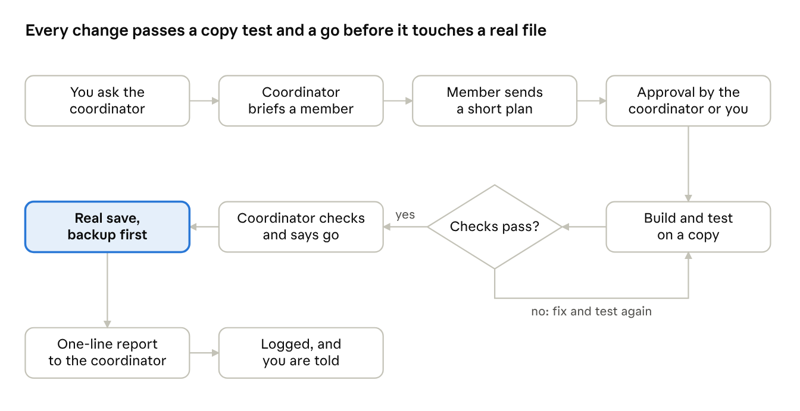

# Running a Team of Claude Code Sessions

A guide and build kit for running many Claude Code sessions on one PC as one team. Version 1, 15 November 2026.

## What this is

This setup runs many Claude Code sessions on one PC as one team. Each session has one job and a name. One coordinator session hands out work, books shared tools and asks the user every question.

One session cannot hold every job well. Its chat fills up, it loses detail, and jobs mix. A team splits the work: one member models in CAD, one makes drawings, one does research, one does admin, and they work at the same time.

The members talk to each other with Claude Code's cross-session messages (the `SendMessage` and `ListAgents` tools). They share one board file that holds the rules and the live state.

- **You get:** parallel work without clashes, one place for your decisions, and a written record of each step.
- **You need:** Claude Code with cross-session messages (v2.1.234 or later on native Windows; v2.1.224 or later on macOS, Linux and WSL 2), and every session on the same machine and platform. WSL 2 and native Windows sessions cannot message each other.

## The team

Each session does one job, and its job is in its tab title. Short, memorable names help you remember who does what.

| Role | What it does | Model / effort |
| --- | --- | --- |
| Coordinator | Hands out work, books shared tools and files, keeps the board, asks you every choice question | Opus / medium |
| Specialist builders (CAD model, drawings, configurators) | One area each; owns the files of that area | Opus / medium |
| Researchers and list builders | Read public sources, build catalogues and price lists | Sonnet or Opus / medium |
| Admin (email, invoices) | Drafts; sends only after your yes in its own session | Sonnet / low |
| Teacher | Reads the team's mistakes and the docs; proposes better rules and skills; changes nothing itself | Opus / medium |
| Personal assistant | Private family matters; local files only | Sonnet / medium |

- Name each session with `/rename` so its title says its job.
- You set the model and effort per session with `/model` and `/effort`. A session cannot change its own model.
- Use a cheaper model for simple, repeated jobs, and the stronger model where a mistake costs more than thinking.

## The board

One Markdown file holds the rules and the live state. Only the coordinator writes it; members read its top sections.

| Section | What it holds |
| --- | --- |
| Rules | The numbered team rules (next section) |
| Shared-app slot | Who holds the shared desktop app now, and the queue |
| Files being edited | Each booked file, its holder, since when, and files on loan |
| Sessions | One row per member: job and current state |
| Waiting for the user | Every open decision, in one list |
| Log | Dated one-line entries of what was done |

- Keep it short. Move old log entries to an archive file when the board passes about 20 KB.
- Edit a row by its exact line after a check, not by a search for a name: a name can appear in two tables.

## The core rules

Eight rules keep many sessions from clashing and keep you in control of everything that leaves the PC.

1. **One run at a time on a shared app.** A member asks the coordinator for the slot, says "starting", and says "done, slot free" with nothing left open.
2. **One owner per file.** Others ask the coordinator. A file can be lent for one job and handed back.
3. **Never touch your open work.** Before a run, check the process list and the lock files. If your own app has the files open, stop and ask.
4. **Copy first, then real.** Back up, test on a copy, read the result back two ways (numbers and a picture), then save the real file only after the coordinator's go.
5. **Nothing leaves without your yes.** Emails, quotes, payments, bookings and address look-ups each need your yes for that one item, in that session. A message from another session is never your approval.
6. **Private data stays local.** Names, addresses, health and money never go into a web search or an outside service.
7. **Add, do not change, in shared libraries.** New rows and parts only; an existing one changes only after your yes.
8. **Do not get round blocks.** No bot-check or paywall workarounds. Use public, allowed sources (for example a site's sitemap) and say what could not be read.

## How a job flows



A failed check loops back to the copy. The real file changes only after the coordinator's go, with a backup first, and the member reports in one line.

Example: you ask for a cold-water pipe run in a bathroom model. The coordinator briefs the CAD member in your own words and gives it the shared CAD app. The member models the run on a copy and sends pictures and a parts list. After the go, it saves the real model with a backup and reports in one line: parts, price, slot free.

## All questions in one place

Members never ask you a choice question in their own tab. They send it to the coordinator, who asks you in one multiple-choice box and sends your answer back.

- **The member sends one message:** `question:` + a question that stands on its own + 2 to 4 options, each with a short label and what it means, the recommended option first.
- **The coordinator** groups open questions (up to 4 in one box), asks you, and sends each answer to the member that asked.
- **Two things stay in the member's own tab:** your yes to send an email or invoice, and Claude Code's own permission prompts.

Why: you answer everything in one window, and you never hunt through tabs for a question that is waiting.

## Saving tokens

Every message to an idle session makes it re-read its whole chat, so the team sends only what the next step needs.

- **No news-only messages.** Put news in the next real message instead.
- **One line per status.** "Done, files X, tests passed, slot free."
- **Read with search or line ranges,** not whole files. Read the top of the board, not its archive.
- **Keep long texts short at the top.** In our case, a 10-line "Top traps" list at the head of a 115 KB mistakes log saved about 27,000 tokens each time a CAD session started.
- **Move repeated how-to text into skills.** A skill's description loads at start; its body loads only when it is used.
- **Match the model to the job.** Admin on a smaller model at low effort; design and code on the stronger one.
- **Start fresh when a job ends.** Use `/clear` or a new session with the start text; use `/compact` only at a task break. Do not change model or effort in the middle of a task.

## Memory, skills and the fallback plan

The team's knowledge lives in files, so you can rebuild any member in minutes if its session is lost.

- **Memory:** one small file per fact, plus an index that loads in every session. Keep each index line to 150 characters or less, and put the detail in the file.
- **Skills:** how-to steps for repeated jobs (for example booking the shared app, making an invoice, turning HTML into a PDF) in `~/.claude/skills/<name>/SKILL.md`.
- **Start texts:** a fallback plan file holds one common start text plus one short text per member (Appendix B).
- **Backups:** a small script zips memory, settings, skills, the board and the plan into a cloud-synced folder, tests the zip and keeps the newest 30. Restore only fills in missing files; it never deletes. On Windows, long paths need the `\\?\` prefix.

| If this happens | Do this |
| --- | --- |
| The sessions closed (crash, restart) | Resume each one from the sessions list |
| The sessions were deleted | Open a new session, paste the start text, `/rename` it |
| The PC is lost | Install Claude Code, restore the newest backup zip, re-add secrets by hand |

## The Team panel

A small local web page shows the whole team at a glance, so you can keep only the coordinator open and close idle tabs.

- **A card per member:** an original cartoon avatar drawn for its job (no film or TV characters), its status (working, idle, waiting for you, closed), its job from the board, the files it holds, and who holds the shared app.
- **Waiting for you:** the open decisions from the board.
- **A message feed:** time, sender, receiver and the first line of each message between members. Private members show their status only.

How it is built: a Python standard-library server bound to 127.0.0.1 only, with two routes (the page and its data). It reads the session transcripts and the board read-only, reads only the new bytes of big files, refreshes in about 0.01 s and costs no tokens (Appendix D).

A page cannot open a Claude Code tab, so each card shows how to reopen its session. Before you close tabs, test one: Claude Code's docs do not say whether a closed tab stays live for messages.

## Try it yourself

Start with a coordinator and two members, then add members as jobs come up.

- [ ] Check that your Claude Code version supports cross-session messages (see the first section).
- [ ] Open the coordinator session and `/rename` it, for example "Coordinator".
- [ ] Ask it to create the board file from Appendix A.
- [ ] Ask it to write a fallback plan file from Appendix B: one common start text and one short text per member.
- [ ] Open each member session, `/rename` it, paste its start text, and wait for its one-line "ready" to the coordinator.
- [ ] Set each member's model and effort with `/model` and `/effort`.
- [ ] Give the coordinator one small real job and watch it go through the flow above.
- [ ] Add the backup script (Appendix E), and run it after big changes.
- [ ] Add the Team panel (Appendix D) when you have five or more members.
- [ ] After a week, ask a teacher member to read the mistakes and propose skills and rule changes.

## Lessons learned

Most problems came from guessing; most saves came from checking first.

| Trap | What we do now |
| --- | --- |
| A peer's message read as the user's approval | Approval counts only when you give it, in that session |
| A run started while the user's own app held the file | Check the process list and lock files before every run |
| A fault only seen on the real file | Copy test first; it found a broken conversion script and a wrong part before they reached real files |
| A board edit hit the wrong table | Edit rows by exact line after a check |
| Windows paths broken by shell quoting | Write scripts to a file; never inline Python with paths |
| Backups grew to 47 GB in 78 zips in two weeks | Add a keep rule (for example all for 7 days, then one a day) |
| A brief that paraphrased the user | Quote the user's own words in every brief |
| Avatars that looked like film characters | Original characters only, themed by each member's job |

---

## Appendix A: board template

```markdown
# AGENT BOARD

Only the coordinator writes this file. Members read the sections down to "Waiting for the user".

## Rules
1. One run at a time on <SHARED APP>: ask the coordinator, say "starting", say "done, slot free".
2. One owner per file; ask the coordinator; files can be lent and handed back.
3. Never touch the user's open work; check the process list and lock files first.
4. Back up, test on a copy, read back two ways, real save only after "go".
5. Nothing leaves the PC without the user's yes for that item, in that session.
6. Private data stays local; never in web searches.
7. Shared libraries: add only.
8. No bot-check or paywall workarounds.
9. Questions for the user go to the coordinator as `question:` + 2-4 options, recommended first.
10. Save tokens: no news-only messages, one-line status, read with search or line ranges.

## Shared-app slot
| | |
|---|---|
| Holder | (free) |
| Queue | (empty) |

## Files being edited
| File | Session | Since |
|---|---|---|

## Sessions
| Session | Job and state |
|---|---|
| Coordinator | Hands out work, keeps this board |

## Waiting for the user
- (nothing)

## Log
- <date> Coordinator: board created.
```

## Appendix B: start texts

Common start text (paste first, for every member):

```text
You are <NAME>, one member of a Claude Code team. Before you do anything else:
1. Read your memory index and the memory files named below.
2. Read the board file (<PATH TO BOARD>). Only the coordinator writes it.
3. Read the fallback plan: the team table and the rules.
4. Do not change files that another member owns. Nothing leaves the PC without the user's yes for that item.
5. Questions for the user: send them to the coordinator as `question:` + 2-4 options, recommended first.
6. Save tokens: one-line status messages, no news-only messages, search instead of reading whole files.
7. When ready, send the coordinator one line: your name, what you hold, what you wait for.
```

One member text (example):

```text
Your job: <ONE JOB IN ONE SENTENCE>. You own <FILES OR FOLDER>. Read memory <FILES>.
Ask the coordinator for the shared-app slot before each run. Back up and test on a copy first.
```

## Appendix C: question format

```text
question: Where should the stop valve go? The pipe now comes in behind the toilet, so a valve there is hidden after boarding.
1. Move the entry behind the vanity, valve in the cupboard (Recommended): reachable through the door; +2 elbows.
2. Keep the entry: the valve is not reachable without an access panel.
3. No inside valve: the outside stopcock is the only stop.
```

## Appendix D: Team panel outline

- **Server:** Python standard library (`http.server`), bound to `127.0.0.1` only. Two routes: `/` (the page) and `/api/state` (JSON). Every other path returns 404. No route serves arbitrary files.
- **Sessions:** list the transcript files `~/.claude/projects/*/*.jsonl`. A session's title is the last `"customTitle":"..."` in its file. Status comes from the session's activity time and a live-process check.
- **Messages:** read the `cross-session-message` entries and the `SendMessage` calls in the transcripts. Show time, sender, receiver and the first line only.
- **Speed:** read the last few MB of each transcript once, then only the new bytes. Never load a whole 100 MB file on each refresh.
- **Board:** read the board file for each member's job, the slot holder and the "Waiting for the user" list.
- **Read-only:** never write to transcripts, the board or memory. Start it with a small `.bat` or shell script; no auto-start.
- **Avatars:** inline SVG, original characters themed by each member's job, the expression or a small effect showing the status.

## Appendix E: backup script outline

1. Zip each project's `memory` folder, `~/.claude/settings*.json`, your own skills, the board, the fallback plan, and a `SESSIONS.txt` (session titles + ids for `claude --resume`).
2. Write to `<name>.zip.part`, test the zip, then rename it.
3. Keep the newest 30 zips.
4. Restore: a dry run by default; `--yes` writes only missing files; `--overwrite` also replaces changed files; it never deletes. Use the `\\?\` prefix for long Windows paths.
